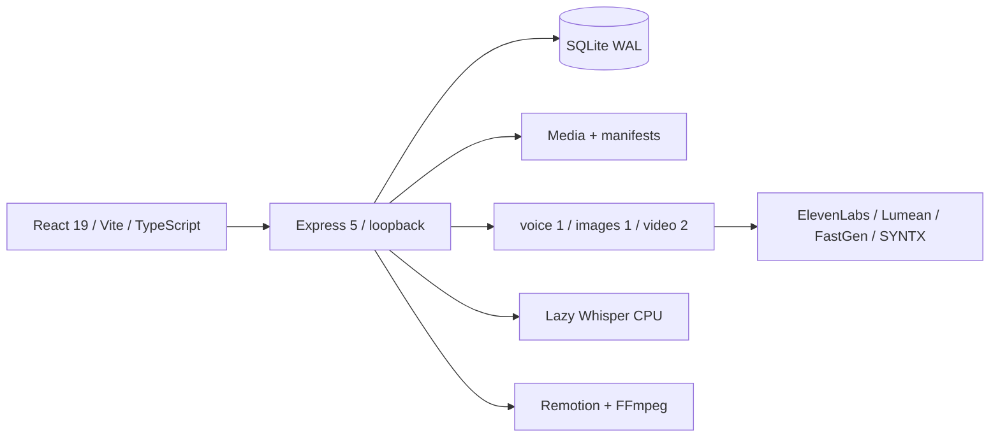
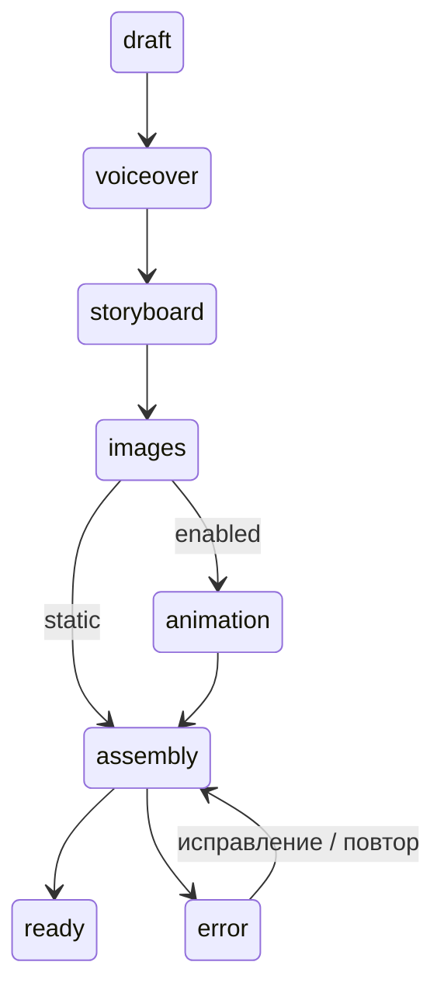

# Архитектура

SQLite — источник истины. STRICT таблицы, prepared statements, WAL, synchronous FULL, foreign keys, busy timeout. Запись новой ревизии коммитится перед атомарным manifest. Если зеркало не записалось, health сообщает предупреждение; запуск восстанавливает зеркала из БД. PATCH со старой ревизией возвращает 409. Мутация без await синхронна в одном процессе Node.

Файлы внутри projects UUID; ссылки относительные. Runtime/config отделены от приложения в customer package. Бэкапы БД — один проверенный снимок на день, последние семь. ZIP проекта включает перечисленные артефакты и manifest; restore проверяет структуры и медиа, назначает новый UUID и пересоздаёт производные субтитры/рендер.

Операция сохраняется до POST. Внешний ID сохраняется сразу после ответа; SYNTX сохраняет отдельный chat ещё до платной генерации. Повтор присоединяется к очереди по operation key. После рестарта создающие задачи становятся uncertain/paused; продолжение запускается пользователем. Это предотвращает скрытую новую оплату, но не гарантирует, что провайдер вернёт средства при отмене.

Редактирование imagePrompt очищает image/video; motion/camera/weight — video/render; текст — соответствующий голос, alignment и render. Новая озвучка сбрасывает зависящие клипы. Смена FPS повторно нормализует существующую внешнюю задачу, когда её результат ещё доступен, без нового create.

## ADR 1: локальный монолит

Один процесс упрощает установку, хранение токенов и согласованность. Компромисс — один пользователь и один локальный сервер; сетевой многопользовательский режим отсутствует.

## ADR 2: embedded SQLite

Не требует отдельной службы БД. Транзакции и ревизии защищают от потерянных сохранений. БД и файловое зеркало не могут коммититься одной транзакцией; порядок и восстановление описаны выше.
